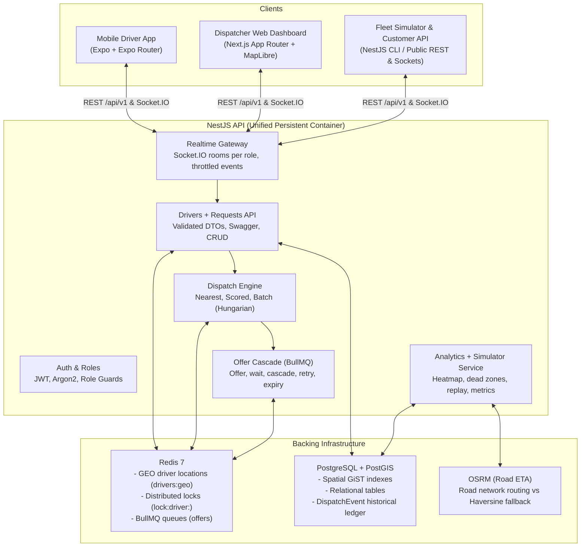

# Fleet Pulse Architecture

Fleet Pulse is a real-time delivery dispatch platform designed with a clean microservices-ready monolithic architecture. One unified NestJS backend serves three distinct clients, supported by Redis for fast geospatial and ephemeral state, and PostgreSQL with PostGIS for reliable transactional persistence and historical analysis.

## System Architecture Diagram

## Core Components
1. **Clients**:
   - **Driver App**: Mobile application built with React Native and Expo Router. Handles live GPS tracking, offer countdown alerts, and trip status transitions.
   - **Dispatcher Web Dashboard**: Real-time operations map built with Next.js App Router, MapLibre GL JS, and OpenStreetMap tiles. Displays vehicle pins, queues, and dispatch analytics.
   - **Simulator & Customer API**: Generates realistic simulated driver movement and automated customer order traffic to stress-test dispatch algorithms.
2. **NestJS API Service**:
   - Runs as a persistent Docker container ensuring continuous WebSocket availability and background queue processing.
3. **Storage & Engines**:
   - **Redis**: High-throughput hot path for GPS coordinate indexing (`GEOADD`/`GEORADIUS`), atomic locks, and BullMQ worker queues.
   - **PostgreSQL + PostGIS**: Cold path relational store with spatial geography indexing (`ST_DWithin` on GiST index) and event sourcing ledger.
   - **OSRM**: Real road-network distance and routing computation with automatic fallback to Haversine straight-line distance.
