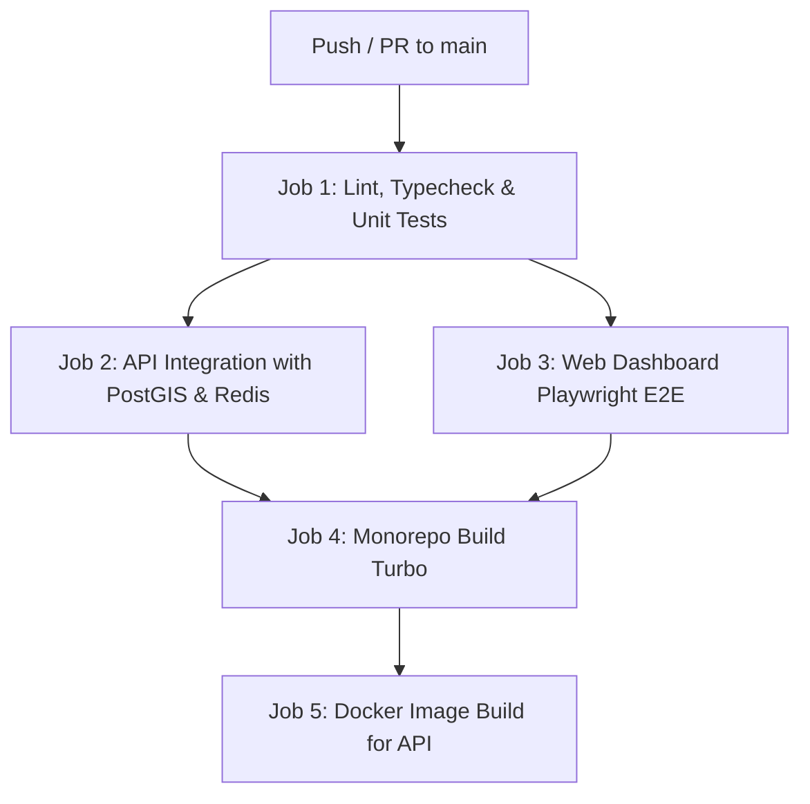

# Fleet Pulse: CI/CD Pipeline & Branch Protection (M11)

This document details the automated GitHub Actions continuous integration pipeline, service container configurations, automated test coverage gates, and GitHub branch protection policy for the Fleet Pulse platform.

---

## 1. CI Pipeline Architecture (`.github/workflows/ci.yml`)

The Fleet Pulse CI workflow triggers on every push and pull request to the `main` branch. It utilizes job-level concurrency cancellation (`cancel-in-progress: true`) to avoid redundant runs on fast iteration.

---

## 2. CI Jobs & Test Matrix

### Job 1: `quality` (Lint, Typecheck & Unit Tests)
- **Environment**: `ubuntu-latest`, Node.js 20, pnpm 9.15 with global store caching (`cache: 'pnpm'`).
- **Steps**:
  1. `pnpm install --frozen-lockfile`
  2. `pnpm --filter @fleet-pulse/api prisma:generate`
  3. `pnpm lint`: Runs ESLint across all workspaces.
  4. `pnpm typecheck`: Validates TypeScript strict mode across API, Web, Mobile, and Shared packages.
  5. **Unit Tests & Coverage Gates**:
     - `@fleet-pulse/shared`: Tests `haversineKm`, ETA calculations, and Zod schemas with Vitest V8 coverage.
     - `@fleet-pulse/mobile`: Tests offline telemetry queue and mobile background services.
     - `@fleet-pulse/api`: Tests dispatch strategies, Hungarian algorithm, PRNG, and security guards with Jest.

#### Coverage Thresholds
- **Geo Code (`packages/shared/vitest.config.ts`)**:
  - Statements: $\ge 95\%$ (Achieved: **100%**)
  - Branches: $\ge 95\%$ (Achieved: **100%**)
  - Functions: $\ge 95\%$ (Achieved: **100%**)
  - Lines: $\ge 95\%$ (Achieved: **100%**)
- **Dispatch Strategies (`apps/api/jest.config.js`)**:
  - Statements: $\ge 90\%$ (Achieved: **93.7%**)
  - Lines: $\ge 90\%$ (Achieved: **94.2%**)
  - Functions: $\ge 80\%$ (Achieved: **81.8%**)
  - Branches: $\ge 70\%$ (Achieved: **75.5%**)

---

### Job 2: `integration-api` (Service Containers)
Runs full Supertest integration and anti-spoofing tests against isolated service containers:
- **Service Containers**:
  - `postgres`: `postgis/postgis:16-3.4-alpine` on port `5432`. Healthcheck: `pg_isready -U fleetpulse -d fleetpulse`.
  - `redis`: `redis:7-alpine` on port `6379`. Healthcheck: `redis-cli ping`.
- **Database Prep**:
  - `pnpm --filter @fleet-pulse/api prisma db push`
  - `pnpm --filter @fleet-pulse/api prisma:seed`
- **Execution**:
  - `pnpm --filter @fleet-pulse/api test:e2e` (runs `app.e2e-spec.ts`, `realtime.e2e-spec.ts`, `simulator.e2e-spec.ts`, `analytics.e2e-spec.ts`, `security.e2e-spec.ts`).

---

### Job 3: `e2e-web` (Playwright E2E)
- **Environment**: Playwright headless Chromium with OS-level dependencies.
- **Execution**: `pnpm --filter @fleet-pulse/web test:e2e`.
- **Artifacts**: Uploads `playwright-report` on failure for post-mortem debugging.

---

### Job 4: `build` (Turbo Monorepo Build)
- Compiles production distributions:
  - `@fleet-pulse/shared` (`dist/index.js`, `dist/index.mjs`, `dist/index.d.ts`)
  - `@fleet-pulse/api` (`dist/main.js`)
  - `@fleet-pulse/web` Next.js standalone SSR bundle

---

### Job 5: `docker-api` (API Docker Container Image)
- Builds production container image using [apps/api/Dockerfile](file:///Users/raj/fleetpulse/apps/api/Dockerfile).
- Uses GitHub Actions layer caching (`cache-from: type=gha`, `cache-to: type=gha,mode=max`) for accelerated builds.

---

## 3. GitHub Branch Protection Policy for `main`

To maintain stability and enforce team standards, configure the following rules under **GitHub Repository Settings $\to$ Branches $\to$ Branch protection rules** for `main`:

### Required Settings:
1. **Require a pull request before merging**:
   - Check *Require approvals* (minimum 1 approval).
   - Check *Dismiss stale pull request approvals when new commits are pushed*.
   - Check *Require review from Code Owners*.
2. **Require status checks to pass before merging**:
   - Check *Require branches to be up to date before merging*.
   - **Mandatory Status Checks**:
     - `Lint, Typecheck & Unit Tests`
     - `API Integration Tests (PostGIS & Redis)`
     - `Web Dashboard Playwright E2E`
     - `Build Monorepo (Turbo)`
     - `Docker Image Build (API)`
3. **Require linear history**:
   - Enforce *Squash and merge* or *Rebase and merge* to prevent messy merge bubbles.
4. **Do not allow bypassing the above settings**:
   - Applies to all administrators and automated bots.
5. **Restrict force pushes and deletions**:
   - Check *Block force pushes*.
   - Check *Block deletions*.
