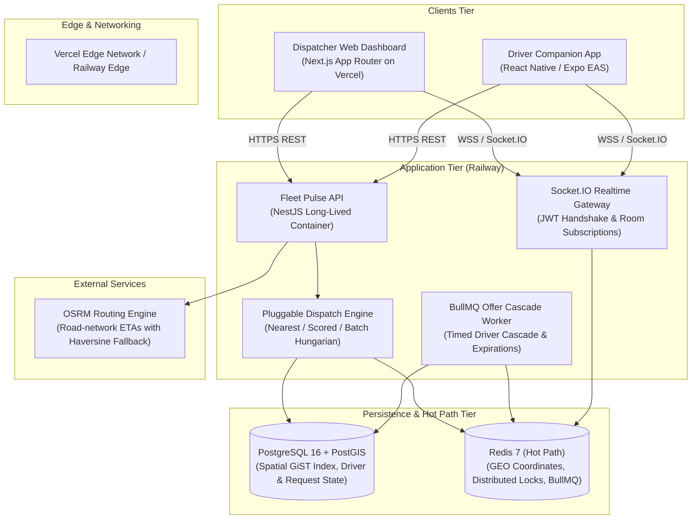

# Fleet Pulse: Production Deployment & Infrastructure Guide (M12)

This document provides complete instructions for deploying, operating, and maintaining the Fleet Pulse platform in production across Railway, Vercel, and EAS (Expo Application Services).

---

## 1. High-Level System Architecture



---

## 2. Environment Variables Specification

All sensitive credentials must be set in the host environment (Railway, Vercel, EAS) and are validated at startup via `validateEnv` in [apps/api/src/config/env.validation.ts](file:///Users/raj/fleetpulse/apps/api/src/config/env.validation.ts).

### 2.1 Fleet Pulse API (`apps/api`)

| Variable | Description | Default | Sensitive |
| :--- | :--- | :--- | :---: |
| `DATABASE_URL` | PostgreSQL connection string with PostGIS enabled | `postgresql://...` | **YES** |
| `REDIS_URL` | Redis URI for GEO storage, distributed locks, BullMQ | `redis://...` | **YES** |
| `JWT_SECRET` | 256-bit secret key used to sign access tokens (1h) | *None* (Required) | **YES** |
| `JWT_REFRESH_SECRET` | 256-bit secret key used to sign refresh tokens (7d) | *None* (Required) | **YES** |
| `PORT` | HTTP server listening port | `4000` | No |
| `NODE_ENV` | Application runtime environment (`production`, `development`) | `development` | No |
| `CORS_ORIGINS` | Comma-separated list of allowed frontend origins (or `*`) | `http://localhost:3000` | No |
| `DISPATCH_STRATEGY` | Active dispatch strategy (`nearest`, `scored`, `batch`) | `scored` | No |
| `OFFER_TIMEOUT_SECONDS`| Seconds driver has to accept before cascade triggers | `20` | No |
| `MAX_OFFER_ATTEMPTS` | Maximum cascade attempts before request expires | `3` | No |
| `BATCH_WINDOW_SECONDS` | Aggregation window duration for batch Hungarian matching | `5` | No |
| `OSRM_URL` | Base URL for OpenStreetMap OSRM routing API | `http://router.project-osrm.org` | No |

### 2.2 Web Dashboard (`apps/web`)

| Variable | Description | Example / Production Value |
| :--- | :--- | :--- |
| `NEXT_PUBLIC_API_URL` | Full REST endpoint path | `https://api-production-0a6663a9.up.railway.app/api/v1` |
| `NEXT_PUBLIC_WS_URL` | Socket.IO gateway base URL | `https://api-production-0a6663a9.up.railway.app` |
| `NEXT_PUBLIC_DISPATCHER_TOKEN` | Optional static token for demo/smoke tests | *Managed JWT* |

### 2.3 Mobile Driver App (`apps/mobile`)

| Variable | Description | Example / Production Value |
| :--- | :--- | :--- |
| `EXPO_PUBLIC_API_URL` | Production API endpoint | `https://api-production-0a6663a9.up.railway.app/api/v1` |
| `EXPO_PUBLIC_SOCKET_URL` | Production WebSocket endpoint | `https://api-production-0a6663a9.up.railway.app` |

---

## 3. Database & Cache Infrastructure Setup

### Option A: Railway Managed Infrastructure (Current Production Setup)
1. **PostGIS**:
   - Provisioned using `postgis/postgis:16-master` image on Railway with persistent volume mounted at `/var/lib/postgresql/data`.
   - PostGIS extension is pre-installed.
   - Internal URL: `${{PostGIS.DATABASE_URL}}`.
2. **Redis**:
   - Provisioned using `redis:7-alpine` image with appendonly persistence enabled and volume at `/data`.
   - Internal URL: `${{Redis.REDIS_URL}}`.

### Option B: Neon / Supabase PostGIS + Managed Redis
1. **Neon / Supabase**:
   - Create a project on [Neon](https://neon.tech) or [Supabase](https://supabase.com).
   - In the SQL Editor, execute:
     ```sql
     CREATE EXTENSION IF NOT EXISTS postgis;
     CREATE EXTENSION IF NOT EXISTS "uuid-ossp";
     ```
   - Copy the Pooled Connection String (port 6543 / PgBouncer for serverless, direct port 5432 for long-lived API containers).
2. **Managed Redis (Upstash / Redis Cloud)**:
   - Create a Redis database with standard eviction policy (`noeviction` or `volatile-lru`).
   - Copy the `redis://...` or `rediss://...` connection string.

---

## 4. Web Dashboard Deployment (Vercel)

1. **Import Repository**:
   - Link your Git repository on [Vercel](https://vercel.com).
   - Select Framework Preset: **Next.js**.
   - Root Directory: `apps/web`.
2. **Build Settings**:
   - Build Command: `cd ../.. && pnpm --filter @fleet-pulse/shared build && pnpm --filter @fleet-pulse/web build`
   - Output Directory: `.next`
   - Install Command: `pnpm install`
3. **Environment Variables**:
   - `NEXT_PUBLIC_API_URL`: `https://api-production-0a6663a9.up.railway.app/api/v1`
   - `NEXT_PUBLIC_WS_URL`: `https://api-production-0a6663a9.up.railway.app`
4. Deploy!

---

## 5. Mobile Driver App Build (Expo EAS)

EAS profiles are configured in [apps/mobile/eas.json](file:///Users/raj/fleetpulse/apps/mobile/eas.json):

1. **Install & Login to EAS CLI**:
   ```bash
   pnpm add -g eas-cli
   eas login
   ```
2. **Configure Project**:
   ```bash
   cd apps/mobile
   eas project:init
   ```
3. **Trigger Android Preview APK Build**:
   ```bash
   eas build --platform android --profile preview
   ```
   *Generates a standalone `.apk` distributable directly to testing devices without Google Play store submission.*
4. **Trigger iOS TestFlight Build**:
   ```bash
   eas build --platform ios --profile preview
   ```

---

## 6. Rollback & Recovery Runbook

### 6.1 API Rollback (Railway)
1. **Instant Rollback**:
   - In the Railway dashboard: Navigate to `api` service $\to$ **Deployments** $\to$ click the previous successful deployment $\to$ **Redeploy**.
   - Or via CLI:
     ```bash
     railway redeploy --service api
     ```
2. **Drain & Zero-Downtime Traffic Switching**:
   - Railway maintains old replica serving while the new deployment runs healthchecks (`drainingSeconds: 15`).

### 6.2 Database Recovery
1. **Schema Rollback**:
   - Schema modifications are additive. To rollback breaking migrations, re-run `npx prisma db push --force-reset` or apply down-migration scripts.
2. **Point-in-Time Recovery**:
   - Volume snapshots are automated on Railway. Restore snapshot via service settings in disaster scenarios.

### 6.3 Web Rollback (Vercel)
1. In Vercel Project Dashboard $\to$ **Deployments** $\to$ click the last known good deployment $\to$ **Promote to Production**. Instant, zero-downtime DNS traffic switch.

---

## 7. Estimated Monthly Infrastructure Costs

### Developer / Free Tier ($0 - $5 / mo)
- **Railway Hobby**: $5.00/mo includes 500 hours compute + 5GB egress.
- **Vercel Hobby**: $0.00/mo (Free for hobby Next.js deployments).
- **Expo EAS**: $0.00/mo (Free tier includes 30 build credits/month).

### Production Scale (500 Drivers, 10,000 requests/day)
| Component | Provider & Tier | Specifications | Monthly Cost |
| :--- | :--- | :--- | :---: |
| **Fleet Pulse API** | Railway Pro | 2 vCPUs, 2 GB RAM, long-lived container | $20.00 |
| **PostGIS Database** | Railway / Neon Pro | 2 vCPUs, 4 GB RAM, 20 GB NVMe Storage | $25.00 |
| **Redis Cache** | Railway / Redis Cloud | 1 GB RAM, persistence enabled | $10.00 |
| **Web Dashboard** | Vercel Pro | Unlimited preview deployments, custom domains | $20.00 |
| **Mobile CI/CD** | EAS Production | High-priority build concurrency | $29.00 |
| **Total Estimated** | | | **~$104.00 / month** |
